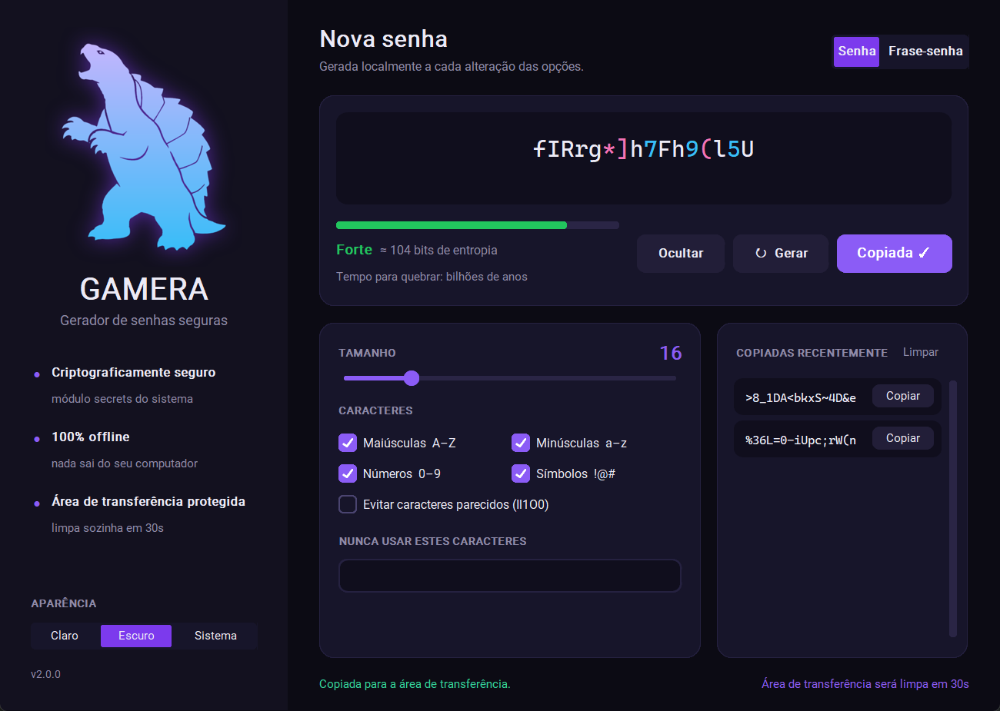
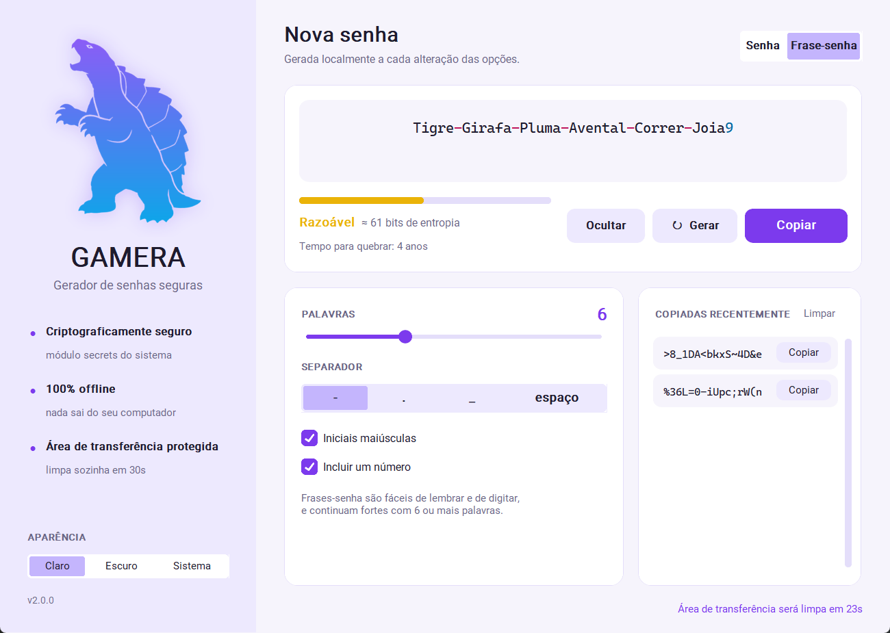

# 🐢 Gamera — Gerador de Senhas Seguras


O **Gamera** é um gerador de senhas e frases-senha para desktop, feito em Python. Ele funciona 100% offline, usa o gerador criptográfico do sistema operacional e tem uma interface moderna com tema claro e escuro, inspirada no lendário kaiju Gamera.



---

## 🚀 Funcionalidades

- 🔒 **Geração criptograficamente segura** com o módulo `secrets`, garantindo pelo menos um caractere de cada grupo escolhido.
- 🧩 **Dois modos:** senha aleatória (4 a 64 caracteres na interface, até 128 no terminal) ou **frase-senha** com palavras em português (`Tigre-Girafa-Pluma-Avental-Correr-Joia9`).
- 📊 **Medidor de força** com entropia em bits e tempo estimado para quebrar a senha.
- 🎛️ **Controle fino:** maiúsculas, minúsculas, números e símbolos; opção para evitar caracteres parecidos (`Il1O0`) e uma lista de caracteres que nunca devem aparecer.
- 📋 **Área de transferência protegida:** a senha copiada é apagada sozinha após 30 segundos (e ao fechar o app), sem apagar o que você copiar depois.
- 🕘 **Histórico da sessão** com as senhas copiadas recentemente. Ele fica só na memória e nada é salvo em disco.
- 🙈 **Mostrar/ocultar** a senha na tela e no histórico.
- 🎨 **Tema claro, escuro ou do sistema**, com caracteres coloridos (números e símbolos em destaque) para facilitar a leitura.
- 💾 **Lembra suas preferências** entre execuções (só as opções, nunca as senhas).
- ⌨️ **Atalhos:** `Ctrl+G` / `F5` gera, `Ctrl+Shift+C` copia, `Ctrl+Shift+H` mostra ou oculta.
- 🖥️ **Modo terminal** para scripts e automações.



---

## ⬇️ Download (Windows)

Baixe o **`Gamera.exe`** na página de [Releases](https://github.com/Prequelunsainted/Gamera-Secure-Password-Generator/releases/latest) e dê dois cliques — não precisa instalar Python.

> Como o executável não é assinado digitalmente, o Windows SmartScreen pode exibir um aviso na primeira execução. Clique em **Mais informações → Executar assim mesmo**.

## 📱 Versão mobile (Android e iPhone)

Na pasta [`mobile/`](mobile) há uma versão do Gamera para celular, feita como **PWA**: instala na tela inicial, abre em tela cheia, funciona offline e usa o mesmo visual e a mesma lógica do app desktop.

**Instalar:** abra **<https://prequelunsainted.github.io/Gamera-Secure-Password-Generator/mobile/>** no celular e
- **Android (Chrome):** menu ⋮ → *Instalar app* (ou toque no botão **Instalar** do próprio app);
- **iPhone (Safari):** botão Compartilhar → *Adicionar à Tela de Início*.

Recursos: modo senha e frase-senha, medidor de força, tema claro/escuro, histórico só na memória, mostrar/ocultar e limpeza da área de transferência 30 s após copiar. Se você sair do app depois de copiar, ele pergunta antes de limpar, para não apagar algo que você copiou depois. As preferências ficam só no aparelho e **senhas nunca são gravadas**.

Para testar no computador:

```bash
python -m http.server 8000 --directory mobile
# abra http://localhost:8000
```

Testes do núcleo JavaScript (precisa do Node 18+; também rodam abrindo `mobile/tests.html` no navegador):

```bash
cd mobile
npm test
```

> A lista de palavras da versão mobile (`mobile/wordlist.js`) vem de `gamera/wordlist.py`. Se alterar uma, regenere a outra. Ao publicar uma nova versão, troque o número em `mobile/sw.js` (`CACHE`) para o celular baixar a atualização.

## 📦 Instalação a partir do código

```bash
git clone https://github.com/Prequelunsainted/Gamera-Secure-Password-Generator.git
cd Gamera-Secure-Password-Generator
pip install -r requirements.txt
```

## ▶️ Como usar

Interface gráfica:

```bash
python -m gamera
```

> O antigo `python password_generator.py` continua funcionando.

Terminal:

```bash
python -m gamera -l 24 -n 5 --stats       # 5 senhas de 24 caracteres + força
python -m gamera --no-symbols --no-ambiguous
python -m gamera -p -w 7 --separator .    # frase-senha com 7 palavras
python -m gamera --help
```

Também é possível instalar como comando (`pip install .`) e rodar apenas `gamera`.

## 🏗️ Gerando o executável

```bash
pip install -r requirements.txt pyinstaller
python build_exe.py
```

O arquivo fica em `dist/Gamera.exe`.

---

## 🧠 Como a força é calculada

- **Senha:** `tamanho × log2(tamanho do alfabeto)`.
- **Frase-senha:** `palavras × log2(tamanho da lista)`, somando os bits do número sorteado.

O tempo para quebrar assume um ataque offline pessimista de **10 bilhões de tentativas por segundo**. Para senhas importantes, mire em **80 bits ou mais**.

---

## 🗂️ Estrutura

```
gamera/
├── core.py        # geração, entropia e força (sem interface, 100% testável)
├── app.py         # interface gráfica (CustomTkinter)
├── assets.py      # silhueta em degradê e ícone gerados a partir do PNG
├── settings.py    # preferências salvas entre execuções
├── wordlist.py    # palavras em português para frases-senha
├── __main__.py    # ponto de entrada e linha de comando
└── assets/gamera.png
mobile/            # versão PWA para Android e iPhone (core.js, app.js, sw.js...)
tests/test_core.py # testes automatizados (Python)
build_exe.py       # gera o Gamera.exe com PyInstaller
```

## ✅ Testes

```bash
python -m unittest discover -s tests -v
```

Os testes também rodam automaticamente no GitHub Actions a cada push.

---

## 🛠️ Tecnologias

- **[Python 3.9+](https://www.python.org/)**
- **[CustomTkinter](https://github.com/TomSchimansky/CustomTkinter):** interface gráfica moderna.
- **[Pillow](https://python-pillow.org/):** tratamento da imagem do Gamera (degradê, brilho e ícone).
- **`secrets`:** gerador de números aleatórios criptograficamente seguro.

## 📄 Licença

Distribuído sob a licença MIT. Veja [LICENSE](LICENSE).
